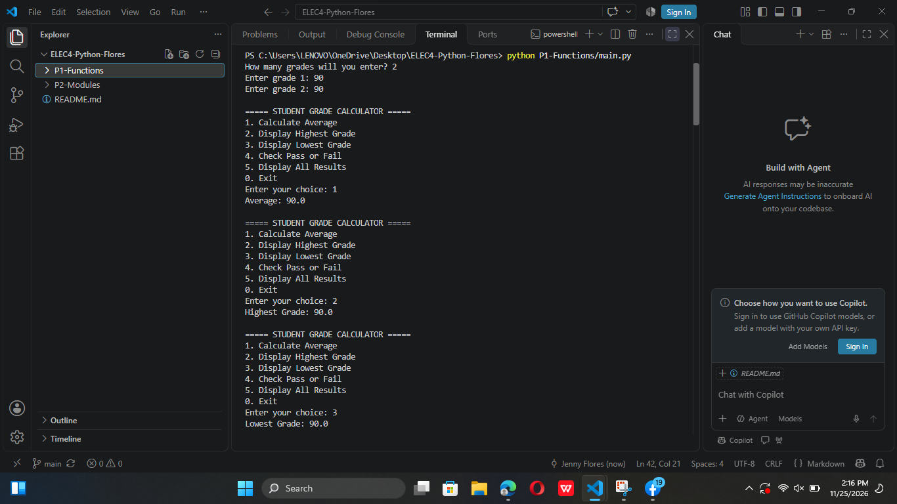
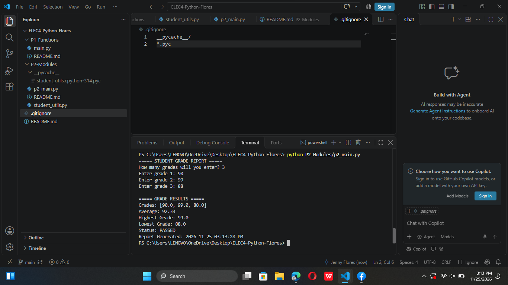
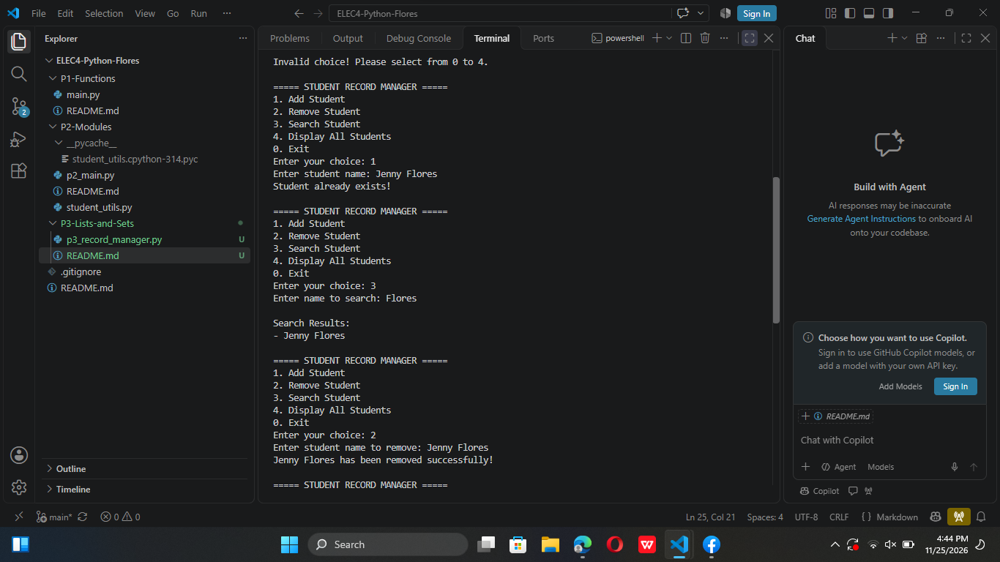
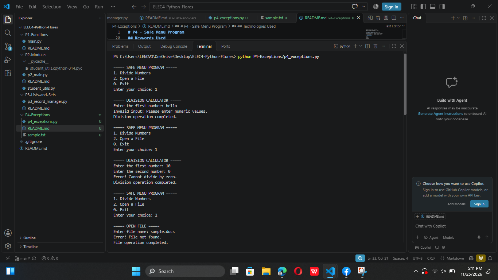
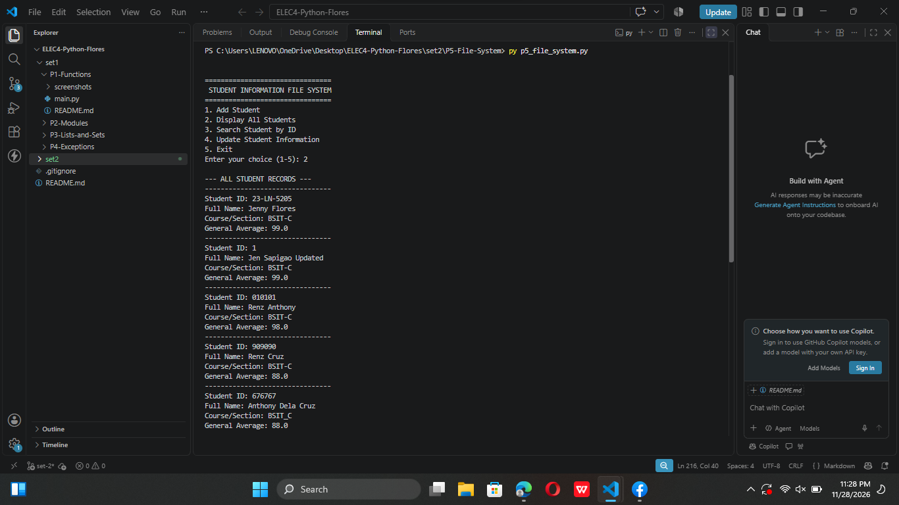
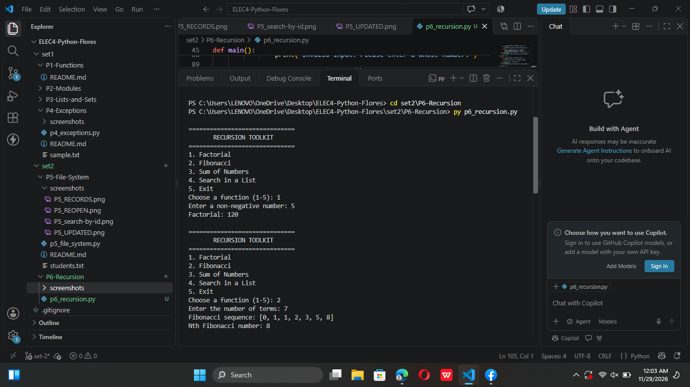
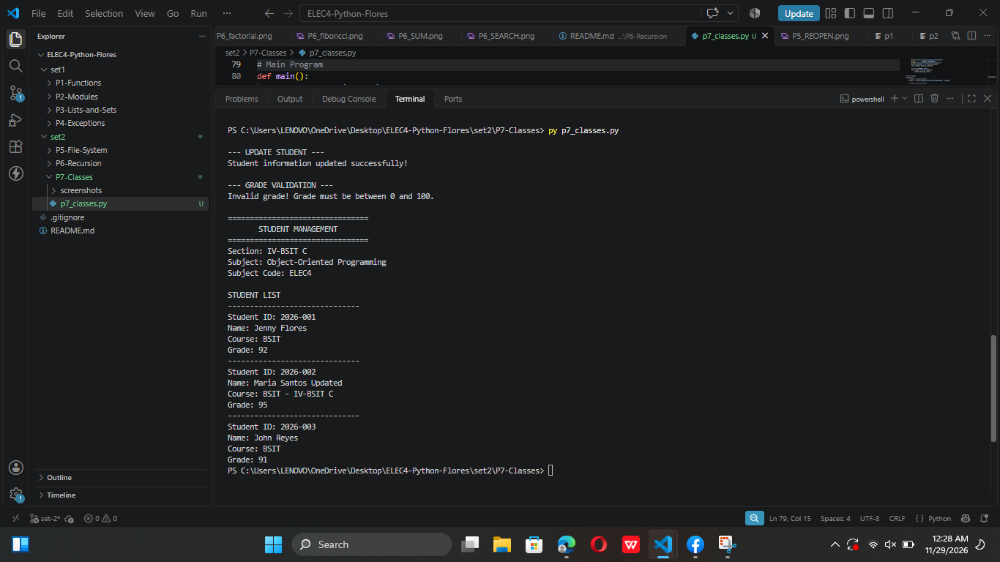
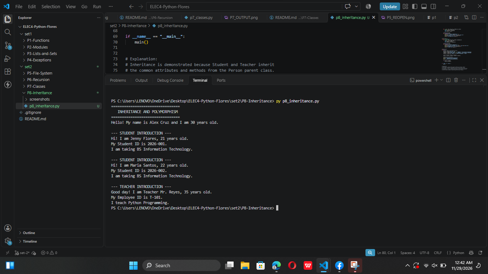

# ELEC4-Python-Flores

**Name:** Jenny Flores  
**Section:** IV-BSIT C  
**Course:** ELEC 4 – Python

This repository contains my Python programming activities for Set 1 and Set 2. Each activity demonstrates the concepts and programming skills covered in the lessons.

---

## Set 1 – Python Fundamentals

### P1 – Functions
Demonstrates the use of Python functions.

**Folder:** [P1-Functions](set1/P1-Functions/)

**Run command:**
```bash
py set1/P1-Functions/main.py
```

**Screenshot:**



### P2 – Modules
Demonstrates how to create and use Python modules.

**Folder:** [P2-Modules](set1/P2-Modules/)

**Run command:**
```bash
py set1/P2-Modules/p2_main.py
```

**Screenshot:**



### P3 – Lists and Sets
Demonstrates the use of lists and sets for managing records.

**Folder:** [P3-Lists-and-Sets](set1/P3-Lists-and-Sets/)

**Run command:**
```bash
py set1/P3-Lists-and-Sets/p3_record_manager.py
```

**Screenshot:**



### P4 – Exceptions
Demonstrates exception handling in Python.

**Folder:** [P4-Exceptions](set1/P4-Exceptions/)

**Run command:**
```bash
py set1/P4-Exceptions/p4_exceptions.py
```

**Screenshot:**



---

## Set 2 – Intermediate Python Programming

### P5 – Student Information File System
Demonstrates file handling through adding, displaying, searching, and updating student records.

**Folder:** [P5-File-System](set2/P5-File-System/)

**Run command:**
```bash
py set2/P5-File-System/p5_file_system.py
```

**Screenshot:**



### P6 – Recursion Toolkit
Demonstrates recursion through factorial, Fibonacci, sum of numbers, and recursive search functions.

**Folder:** [P6-Recursion](set2/P6-Recursion/)

**Run command:**
```bash
py set2/P6-Recursion/p6_recursion.py
```

**Screenshot:**



### P7 – Student Management System with Classes
Demonstrates object-oriented programming using classes, objects, encapsulation, and methods.

**Folder:** [P7-Classes](set2/P7-Classes/)

**Run command:**
```bash
py set2/P7-Classes/p7_classes.py
```

**Screenshot:**



### P8 – Inheritance and Polymorphism
Demonstrates inheritance, parent and child classes, method overriding, and polymorphism.

**Folder:** [P8-Inheritance](set2/P8-Inheritance/)

**Run command:**
```bash
py set2/P8-Inheritance/p8_inheritance.py
```

**Screenshot:**



---

## Repository Structure

```text
ELEC4-Python-Flores/
│
├── set1/
│   ├── P1-Functions/
│   ├── P2-Modules/
│   ├── P3-Lists-and-Sets/
│   └── P4-Exceptions/
│
├── set2/
│   ├── P5-File-System/
│   ├── P6-Recursion/
│   ├── P7-Classes/
│   └── P8-Inheritance/
│
└── README.md
```

**All activities are organized by set and include their corresponding Python source files and screenshots.**